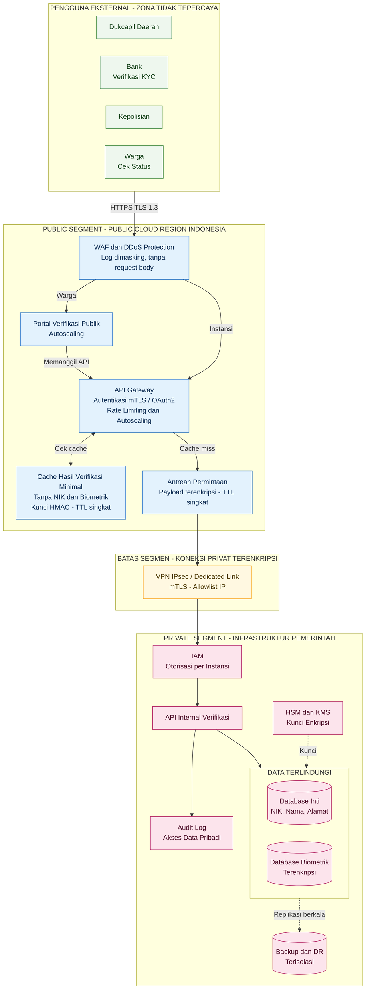
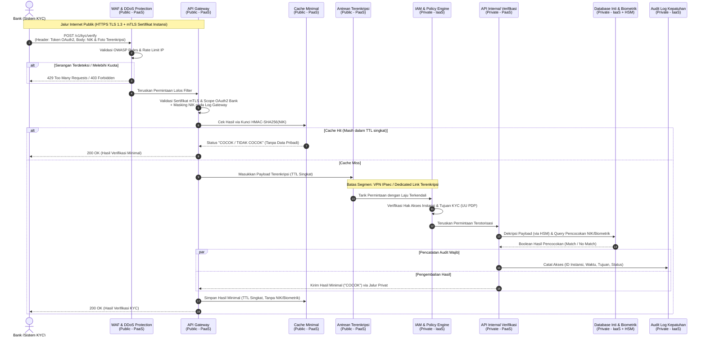
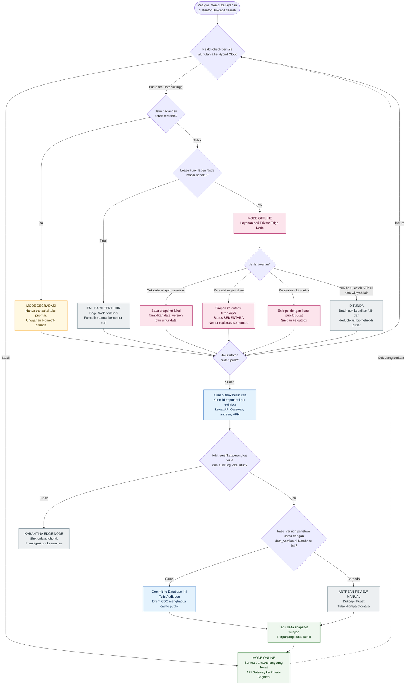

# Tugas 9 (Pekan 9) — Cloud Delivery & Deployment Model

**Materi terkait:** Karakteristik esensial cloud computing (NIST SP 800-145), Deployment Model (Public/Private/Hybrid/Community), Service Model (IaaS/PaaS/SaaS).

> Bagian 2 mata kuliah ini murni **analisis & desain di atas kertas** — tidak ada biaya cloud sama sekali, karena tugas berhenti di tahap rekomendasi, bukan implementasi nyata (implementasi baru mulai Tugas 11).

## Studi Kasus

Pemerintah ingin membangun **Sistem Data Kependudukan** (nama, NIK, alamat, data biometrik) yang:
- Sangat **rahasia** (data pribadi warga negara, diatur UU Perlindungan Data Pribadi).
- Diakses oleh **ribuan instansi** (dukcapil daerah, kepolisian, bank untuk verifikasi KYC) dengan pola akses yang **tidak rata** (lonjakan saat musim pemilu/pendaftaran sekolah).
- Butuh **skalabilitas** agar tidak downtime saat lonjakan akses, tapi **tidak boleh** datanya berada di infrastruktur yang tidak terkendali penuh oleh negara.

## Tugas Kelompok

1. **Rekomendasikan Deployment Model** (Public / Private / Hybrid / Community Cloud) yang paling tepat untuk sistem ini. Jelaskan alasannya berdasarkan **karakteristik NIST** (on-demand self-service, broad network access, resource pooling, rapid elasticity, measured service) dikaitkan dengan kebutuhan kerahasiaan vs skalabilitas.
2. **Rekomendasikan Service Model** (IaaS / PaaS / SaaS) yang tepat untuk komponen-komponen berbeda dari sistem ini (boleh berbeda service model untuk komponen berbeda, mis. database inti vs portal publik untuk pengecekan status).
3. Jelaskan **minimal 2 risiko spesifik** dari pilihan kalian dan mitigasinya (mis. jika Hybrid Cloud dipilih: risiko sinkronisasi data antara private & public segment).
4. Bandingkan singkat dengan **satu alternatif yang kalian tolak** — kenapa alternatif itu kurang tepat (mis. kenapa Public Cloud murni ditolak, atau kenapa Private Cloud murni dianggap kurang skalabel).

## Struktur Submission

```
tugas-09-cloud-delivery-deployment/
├── README.md      # Analisis lengkap (isi dengan poin 1-4 di atas)
├── JURNAL.md
└── bukti/          # (opsional) diagram pendukung
```

## Rubrik Penilaian (Tugas 9)

| Komponen | Bobot | Kriteria |
|---|---|---|
| Ketepatan rekomendasi deployment model | 30% | Argumen berbasis karakteristik NIST, bukan sekadar "private cloud lebih aman" tanpa detail |
| Ketepatan rekomendasi service model | 25% | Pemetaan komponen sistem ke IaaS/PaaS/SaaS masuk akal |
| Analisis risiko & mitigasi | 25% | Risiko spesifik ke konteks data kependudukan (bukan risiko generik) |
| Perbandingan dengan alternatif yang ditolak | 20% | Argumen penolakan jelas dan berdasar |

## Batasan Penggunaan AI (Level 2)

Kebijakan **Level 2 (AI Assisted Idea Generation & Structuring)** berlaku — lihat [`../RUBRIK-UMUM.md`](../RUBRIK-UMUM.md). Boleh bertanya ke AI gambaran umum karakteristik NIST/deployment model untuk brainstorming; **tidak boleh** meminta AI menuliskan rekomendasi/analisis akhir yang tinggal ditempel ke `README.md`. Catat pemakaian AI di "Log Penggunaan AI" pada `JURNAL.md`.

- Jawaban yang terasa seperti "template" (bisa dipakai untuk sistem cloud apa saja tanpa menyebut spesifik kependudukan/data pribadi/regulasi) akan dinilai rendah pada komponen ketepatan rekomendasi.
- `README.md` wajib membahas minimal satu skenario tandingan yang kalian buat sendiri (mis. "bagaimana jika instansi daerah tidak punya infrastruktur private cloud sendiri?") beserta jawabannya.


## Bagian 1 - Rekomendasi Deployment Model & Pemetaan Karakteristik NIST

### 1.1 Rekomendasi: Hybrid Cloud dengan Pemisahan Segmen Berbasis Klasifikasi Data

Kami merekomendasikan **Hybrid Cloud** untuk Sistem Data Kependudukan. Prinsip pemisahannya bukan "sebagian di private, sebagian di public" secara acak, melainkan berdasarkan klasifikasi data dan sifat beban kerja:

| Segmen | Lokasi | Isi | Alasan |
| :--- | :--- | :--- | :--- |
| **Private Segment** | Private cloud pemerintah / pusat data nasional (dikelola penuh oleh negara, di wilayah Indonesia) | Database inti (NIK, nama, alamat), **database biometrik** (sidik jari, iris, wajah), HSM/KMS untuk kunci enkripsi, IAM & audit log | Data pribadi bersifat spesifik (biometrik) menurut UU No. 27/2022 tentang PDP. Kendali fisik, kunci enkripsi, dan akses harus sepenuhnya di tangan negara. |
| **Public Segment** | Public cloud dengan region di Indonesia | WAF, API Gateway, portal verifikasi/cek status, cache hasil verifikasi minimal (berumur singkat), antrean permintaan terenkripsi | Lapisan ini hanya melewatkan permintaan dan hanya boleh menyimpan hasil verifikasi minimal (misalnya "cocok / tidak cocok"). NIK, data biometrik, dan data pribadi lain. |

Intinya, kerahasiaan dijaga dengan menempatkan data di private segment, sedangkan skalabilitas dicapai dengan menempatkan lapisan akses di public segment. Dua kebutuhan yang tampak bertentangan dalam studi kasus ini dipisahkan ke dua segmen yang berbeda.

> **Dasar regulasi:** UU No. 27 Tahun 2022 (PDP) mengategorikan data biometrik sebagai data pribadi yang bersifat spesifik dengan perlindungan lebih ketat. PP No. 71 Tahun 2019 (PSTE) pada pokoknya mewajibkan penyelenggara sistem elektronik lingkup publik mengelola dan memproses sistem serta data elektroniknya di wilayah Indonesia. Karena itu **public segment kami batasi pada region Indonesia** dan tidak menyimpan data inti.

### 1.2 Batasan Data pada Public Segment

Permintaan verifikasi (seperti KYC dari bank) memuat NIK sebagai data pribadi. Artinya, public segment tetap bersentuhan dengan data pribadi karena dilalui oleh data tersebut, sehingga batasan desain berikut diterapkan:

| # | Batasan | Penerapan teknis |
| :--- | :--- | :--- |
| 1 | NIK tidak disimpan di cache, antrean persisten, maupun penyimpanan apa pun di Public Cloud. | NIK hanya ada di memori pemrosesan selama permintaan diteruskan. Kunci cache tidak memakai NIK mentah, melainkan HMAC-SHA256 dengan kunci rahasia (bukan hash polos, karena ruang NIK kecil dan mudah ditebak dengan brute force). Kunci HMAC dikelola dari KMS/HSM di private segment. |
| 2 | Cache hanya menyimpan hasil verifikasi minimal dengan masa berlaku singkat. | Isi cache: status ("cocok / tidak cocok") dan timestamp saja. TTL pendek (misalnya hitungan menit, nilai pastinya ditentukan kebijakan instansi), tanpa nama, alamat, atau biometrik. Cache bersifat opsional: manfaat utamanya untuk portal cek status yang pola aksesnya berulang. Untuk KYC bank yang tingkat pengulangannya rendah, cache boleh dimatikan. |
| 3 | Permintaan sensitif diteruskan lewat koneksi terenkripsi. | TLS 1.3 dari instansi ke gateway, lalu mTLS lewat VPN IPsec/dedicated link ke private segment. Untuk permintaan sensitif ditambahkan enkripsi tingkat field (payload NIK dienkripsi dengan kunci publik private segment), sehingga NIK tetap terlindungi sekalipun TLS diakhiri di WAF/gateway publik. |
| 4 | Data sensitif tidak boleh masuk log secara mentah. | Log di WAF, gateway, dan portal memakai masking atau redaction (misalnya `NIK=3578********0001` atau diganti ID transaksi). Request body tidak dicatat. Log lengkap yang memuat identitas hanya ada di Audit Log private segment. |
| 5 | Antrean permintaan tidak menyimpan NIK terbuka. | Pesan di antrean berisi payload terenkripsi (kunci dari private segment) dengan TTL pendek. Antrean tidak membuat arsip permanen. Permintaan yang kedaluwarsa dibuang dan instansi diminta mengirim ulang. |
| 6 | Tidak ada data biometrik yang melintas ke public segment. | Verifikasi biometrik dilakukan sepenuhnya di private segment. Public segment hanya menerima hasilnya. |

Dengan batasan ini, risiko pada public segment turun dari "menyimpan data pribadi" menjadi "dilalui data pribadi secara sementara dan terenkripsi". Paparan data pada public segment dibuat sekecil dan sesingkat mungkin.

### 1.3 Pemetaan ke 5 Karakteristik Esensial NIST (SP 800-145)

| Karakteristik NIST | Penerapan pada Hybrid Cloud Sistem Kependudukan | Hubungan Kerahasiaan vs Skalabilitas |
| :--- | :--- | :--- |
| **On demand self service** | Tim TI Dukcapil Pusat dapat menyediakan sendiri API key, kuota, dan environment untuk instansi baru (misalnya bank yang baru bekerja sama) lewat portal tanpa tiket manual ke vendor. Pembuatan kredensial tetap melewati approval workflow dan IAM di private segment. | Kemandirian provisioning dipertahankan, tetapi hak akses tidak otomatis diberikan. Self-service berlaku untuk sumber daya, bukan untuk izin akses data. |
| **Broad network access** | Ribuan instansi (dukcapil daerah, kepolisian, bank) mengakses lewat satu API Gateway publik berbasis HTTPS/TLS 1.3 dan mTLS, dari berbagai jaringan dan perangkat. | Hanya gateway di public segment yang terekspos internet. Database inti tidak punya alamat publik dan hanya dapat dijangkau lewat jalur privat (VPN IPsec / koneksi dedicated). |
| **Resource pooling** | Public segment memakai kumpulan sumber daya multi-tenant milik penyedia cloud untuk melayani beban gabungan ribuan instansi. Private segment memakai pool internal yang eksklusif untuk negara. | Multi-tenancy hanya diterima untuk lapisan yang tidak memuat data mentah. Data NIK dan biometrik tidak pernah berbagi hardware dengan tenant lain. |
| **Rapid elasticity** | Saat musim pemilu atau pendaftaran sekolah, API Gateway dan portal verifikasi di public segment di autoscale secara horizontal, lalu diturunkan setelah lonjakan reda. Antrean dan rate limiting melindungi database inti dari banjir permintaan. | Ini inti alasan memilih Hybrid. Private cloud murni harus dibeli untuk kapasitas puncak, yang idle sebagian besar tahun. Elastisitas hanya terjadi di lapisan depan, sehingga data tidak ikut "menyebar" saat skala naik. |
| **Measured service** | Pemakaian diukur per instansi: jumlah request API, volume verifikasi, dan latensi. Di public segment dasar penagihan pay-per-use. Di private segment metering dipakai untuk kuota, *chargeback* antar-instansi, dan audit akses data pribadi. | Metering sekaligus menjadi alat kepatuhan. Setiap akses ke data warga tercatat (siapa, kapan, tujuan), yang berguna untuk pembuktian akuntabilitas sesuai UU PDP dan deteksi anomali. |

### 1.4 Narasi Analisis

Sistem kependudukan memiliki dua sifat yang saling bertentangan: data sangat sensitif dan pola akses sangat fluktuatif. **Private Cloud murni** memenuhi kendali tetapi gagal pada rapid elasticity, karena kapasitas harus dibangun untuk puncak pemilu yang hanya terjadi sesekali. Public Cloud murni memenuhi elastisitas tetapi menempatkan data biometrik pada infrastruktur resource pooling milik pihak ketiga, yang bertentangan dengan tuntutan kendali penuh negara dan kewajiban pemrosesan data di wilayah Indonesia.

**Hybrid Cloud** menyelesaikan konflik ini dengan memanfaatkan karakteristik NIST secara selektif. Resource pooling dan rapid elasticity dipakai penuh di lapisan akses yang tidak menyimpan data sensitif. Sementara itu di private segment, resource pooling dibatasi pada pool eksklusif milik negara, dan measured service diarahkan ke audit akses. Broad network access disediakan hanya lewat satu pintu terkontrol (API Gateway), sedangkan on demand self service dibatasi pada penyediaan sumber daya, bukan pemberian hak atas data. Dengan demikian, setiap karakteristik NIST tidak hanya terpenuhi, tetapi juga disesuaikan dengan tingkat sensitivitas data pada segmennya.

### 1.5 Diagram Deployment



**Keterangan diagram:**
- **Biru (Public Segment):** komponen yang boleh diskalakan otomatis. Tidak menyimpan data inti, NIK, maupun biometrik. NIK hanya dilalui secara sementara dan terenkripsi, dan tidak pernah masuk log mentah.
- **Merah muda (Private Segment):** data NIK dan biometrik, kunci enkripsi, dan audit log. Tidak terekspos internet.
- **Kuning (Batas Segmen):** satu-satunya jalur penghubung, terenkripsi dan dibatasi allowlist.
- Cache di public segment hanya menyimpan hasil verifikasi minimal berumur pendek, tidak berisi NIK maupun data biometrik. Kunci cache berupa HMAC, bukan NIK mentah.

### 1.6 Penjelasan Alur Diagram

1. Pengguna eksternal (bank, kepolisian, Dukcapil daerah, warga) mengirim permintaan lewat internet dengan HTTPS (TLS 1.3).
2. WAF dan DDoS protection menyaring serangan jaringan. Warga dilayani Portal Verifikasi, sedangkan instansi langsung menuju API Gateway.
3. API Gateway melakukan autentikasi (mTLS/OAuth2) dan rate limiting. Portal juga memanggil gateway ini, sehingga hanya ada satu pintu menuju private segment.
4. Gateway mengecek cache. Jika ada hasil minimal yang masih berlaku, hasil langsung dikembalikan tanpa menyentuh private segment.
5. Jika tidak ada (cache miss), permintaan masuk antrean sebagai penyangga lonjakan, lalu diteruskan dengan laju terkendali lewat VPN IPsec atau Dedicated Link terenkripsi.
6. Di private segment, IAM memeriksa otorisasi instansi, lalu API Internal memproses permintaan.
7. API Internal mengakses database inti dan biometrik. Kunci enkripsi dikelola HSM/KMS.
8. API Internal menulis audit log. Hasil minimal kembali lewat jalur yang sama dan boleh disimpan di cache dengan TTL singkat.
9. Di luar alur permintaan: database direplikasi secara berkala ke backup/DR yang terisolasi.


## Bagian 2 - Rekomendasi Service Model per Komponen Sistem

Agar pemisahan tanggung jawab antara keamanan data pribadi dan skalabilitas akses berjalan efektif di atas arsitektur **Hybrid Cloud**, Sistem Data Kependudukan dipecah menjadi empat kelompok komponen utama dengan model layanan (*service model*) yang berbeda sesuai tingkat sensitivitas datanya.

### 2.1 Pemetaan Komponen ke Service Model (IaaS / PaaS / SaaS)

| # | Komponen Sistem | Segmen & Lokasi | Service Model | Argumen Pemilihan (Efisiensi & Keamanan) |
| :--- | :--- | :--- | :--- | :--- |
| **1** | **Database Inti & Biometrik** (`DB_INTI`, `DB_BIO`, `HSM/KMS`) | **Private Segment**<br>*(Pusat Data Nasional / On-Premise)* | **IaaS**<br>*(Private Infrastructure as a Service)* | **Kontrol penuh hingga level OS & enkripsi.** Data biometrik (sidik jari, iris, wajah) dan NIK adalah data spesifik menurut UU No. 27/2022 (UU PDP). Dengan IaaS di infrastruktur pemerintah, tim keamanan negara memegang kendali penuh atas *hardening* sistem operasi, partisi penyimpanan terenkripsi, konfigurasi *firewall* internal, serta manajemen kunci di HSM/KMS tanpa intervensi abstraksi pihak ketiga. |
| **2** | **API Gateway, Antrean & Cache Verifikasi** (`API Gateway`, `Message Queue`, `Cache Minimal`) | **Public Segment**<br>*(Public Cloud Region Indonesia)* | **PaaS**<br>*(Platform as a Service)* | **Elastisitas instan tanpa beban administrasi server.** Saat lonjakan ekstrem seperti hari pemungutan suara pemilu atau PPDB serentak, layanan *managed* API Gateway dan *message broker* (PaaS) melakukan *autoscaling* otomatis dan menangani *rate limiting* maupun terminasi mTLS secara *built-in*. Negara tidak perlu memelihara *patching* OS pada lapisan gerbang yang tidak menyimpan data mentah ini. |
| **3** | **Portal Verifikasi Publik & Layanan Internal** (`Portal Cek Status`, `API Internal Verifikasi`) | **Hybrid**<br>*(Portal di Public Segment; API Internal di Private Segment)* | **PaaS**<br>*(Managed Container / App Platform)* | **Fokus pada logika bisnis & isolasi aplikasi.** Penggunaan PaaS berbasis kontainer terkelola mempercepat *deployment* pembaruan aturan validasi NIK dan fitur *masking* log. Karena *runtime* dan *load balancer* dikelola oleh platform, tim pengembang Dukcapil cukup fokus pada keamanan kode aplikasi dan validasi skema permintaan. |
| **4** | **Monitoring, Observability & Kolaborasi Operasional** (`SIEM Dashboard`, `Notifikasi Insiden`) | **Hybrid / Operasional**<br>*(Metadata ter-masking)* | **SaaS** *(Terbatas)* / **Self-Hosted** | **Efisiensi operasional non-data inti.** Perangkat lunak kolaborasi tiket insiden antar-instansi atau pemantauan kesehatan infrastruktur (*uptime/latency* gerbang publik) dapat memanfaatkan SaaS untuk efisiensi biaya dan kecepatan adopsi, **dengan syarat mutlak** tidak pernah menerima payload NIK, nama, atau data biometrik (hanya ID transaksi anonim dan metrik performa). |

Pemetaan ini mengikuti prinsip *Shared Responsibility Model*. Semakin dekat komponen ke penyimpanan data kependudukan mentah, semakin rendah tingkat abstraksinya (**IaaS**) agar kendali negara tetap mutlak. Sebaliknya, pada lapisan terluar yang menghadapi jutaan permintaan per menit namun bersifat *stateless*, abstraksi dinaikkan ke **PaaS** demi kecepatan skala.

---

### 2.2 Alur Verifikasi End-to-End (Sequence Diagram)

Diagram berikut menggambarkan alur pemrosesan permintaan verifikasi **KYC (Know Your Customer)** dari instansi eksternal (Bank) hingga ke database inti di *Private Segment*, termasuk titik-titik validasi keamanan, pengecekan *cache* terenkripsi HMAC, dan pencatatan audit.



---

### 2.3 Penjelasan Titik Kontrol & Validasi pada Alur

1. **Validasi Perimeter & Identitas Instansi (Langkah 1–5):** Permintaan dari Bank harus melewati pemeriksaan lapisan jaringan di **WAF** dan autentikasi kriptografis dua arah (**mTLS** + token **OAuth2**) di **API Gateway (PaaS)**. Permintaan tanpa sertifikat resmi instansi terdaftar langsung ditolak di segmen publik sebelum menyentuh infrastruktur negara.
2. **Pencegahan Kebocoran di Cache Publik (Langkah 6–10):** API Gateway tidak pernah mencari *cache* menggunakan nomor NIK mentah, melainkan menggunakan nilai *hash* kriptografis (**HMAC-SHA256**). Jika terjadi *cache hit*, respons dikembalikan dalam milidetik tanpa membebani database inti.
3. **Penyangga Lonjakan & Otorisasi UU PDP (Langkah 11–14):** Saat *cache miss* (misalnya pada lonjakan pembukaan rekening serentak atau pemilu), permintaan masuk ke **Antrean Terenkripsi** sebagai *buffer* agar database tidak mengalami *overload*. Sebelum menyentuh database, **IAM** di *Private Segment* memverifikasi apakah instansi pemohon memang memiliki dasar hukum/izin untuk mengakses jenis data tersebut.
4. **Pemrosesan Terisolasi & Audit Log (Langkah 15–19):** Dekripsi *payload* dan pencocokan biometrik hanya terjadi di dalam **IaaS Private Segment** menggunakan kunci yang dikelola **HSM**. Setiap transaksi langsung direkam ke **Audit Log** yang terisolasi untuk memenuhi kewajiban akuntabilitas pengawasan data pribadi sebelum hasil biner (*cocok/tidak cocok*) dikembalikan ke Bank.


## Bagian 3 - Analisis Risiko & Mitigasi
 
Risiko pada bagian ini diturunkan langsung dari arsitektur yang dipilih di Bagian 1 dan 2: Hybrid Cloud dengan cache hasil verifikasi di public segment, API Gateway yang melayani ribuan instansi mitra, serta komponen PaaS/SaaS di public cloud. Risiko generik seperti "server mati" atau "diretas" sengaja tidak dibahas. Fokusnya pada hal yang hanya muncul karena sistem ini mengelola **data kependudukan** dan berada di bawah **UU No. 27/2022 (PDP)** serta **PP No. 71/2019 (PSTE)**.
 
### 3.1 Risiko 1 - Inkonsistensi Status NIK antara Private Segment dan Cache Public Segment
 
**Skenario.** Data kependudukan tidak statis. Setiap hari ada warga yang meninggal, pindah domisili, berganti status perkawinan, atau NIK-nya dinonaktifkan karena terbukti ganda. Perubahan ini dicatat di database inti (private segment), tetapi cache di public segment masih menyimpan hasil lama (`COCOK`) sampai TTL habis. Selain itu, pemutakhiran dari Dukcapil daerah sering masuk secara batch, sehingga ada jeda antara kejadian nyata dan perubahan di database inti.
 
**Kenapa spesifik ke data kependudukan.** Selama jendela inkonsistensi itu, sistem bisa menyatakan NIK orang yang sudah meninggal masih valid. Akibatnya:
- Bank bisa membuka rekening atau pinjol bisa mencairkan pinjaman atas nama warga yang sudah meninggal (penipuan identitas).
- Pada musim pemilu, NIK yang seharusnya sudah dinonaktifkan masih lolos verifikasi pendaftaran pemilih, sehingga muncul pemilih ganda di DPT.
- Pada PPDB, alamat lama di hasil verifikasi bisa membuat seleksi zonasi menggunakan domisili yang sudah tidak berlaku.

**Mitigasi teknis.**
1. **Invalidasi cache berbasis event (Change Data Capture).** Setiap perubahan status di database inti memicu event `NIK_STATUS_CHANGED`. Event hanya berisi kunci HMAC NIK (bukan NIK mentah) dan dikirim ke public segment lewat jalur privat. Gateway langsung menghapus entri cache dengan kunci tersebut, tanpa menunggu TTL habis.
2. **Cache bypass untuk transaksi berisiko tinggi.** Permintaan KYC pembukaan rekening, pencairan kredit, dan verifikasi DPT selalu diteruskan ke private segment. Cache hanya dipakai untuk portal cek status warga yang sifatnya informatif. Ini menegaskan batasan di Bagian 1.2 bahwa cache untuk KYC boleh dimatikan.
3. **Nomor versi data di setiap hasil.** Setiap respons membawa `data_version` (nomor urut perubahan terakhir NIK tersebut). Jika versi di cache lebih kecil dari versi terbaru yang diumumkan private segment, entri dianggap kedaluwarsa.
4. **Rekonsiliasi berkala dan SLA pemutakhiran daerah.** Job harian membandingkan ringkasan (checksum) status NIK antara data daerah dan database inti. Selisih dilaporkan ke Dukcapil daerah yang bersangkutan untuk diselesaikan dalam batas waktu tertentu.

### 3.2 Risiko 2 - Penyalahgunaan Akses API oleh Instansi Mitra (Enumerasi dan Harvesting Data)
 
**Skenario.** Ancaman paling realistis bukan peretas dari luar, tetapi instansi mitra yang punya kredensial sah: oknum di bank, perusahaan fintech yang bekerja sama, atau kredensial mitra yang bocor dan dipakai pihak lain. API hanya mengembalikan `COCOK / TIDAK COCOK`, tetapi itu sudah cukup untuk dijadikan **oracle verifikasi**. Penyerang mengirim pasangan NIK + nama secara massal, lalu menyimpan pasangan yang `COCOK` untuk membangun basis data identitas tervalidasi.
 
**Kenapa spesifik ke data kependudukan.** Struktur NIK membuat serangan ini murah. NIK terdiri dari 16 digit: 6 digit kode wilayah, 6 digit tanggal lahir (ditambah 40 untuk perempuan), dan 4 digit nomor urut. Jika penyerang tahu kecamatan dan perkiraan tanggal lahir korban, ruang tebakannya hanya puluhan ribu kombinasi. Data yang terkumpul bisa dipakai untuk pendaftaran pinjol ilegal, registrasi SIM card, atau rekayasa sosial. Selain itu, akses di luar tujuan KYC melanggar prinsip pembatasan tujuan dalam UU PDP, dan negara sebagai pengendali data ikut menanggung akibatnya.
 
**Mitigasi teknis.**
1. **Purpose binding di setiap permintaan.** Setiap permintaan wajib membawa ID referensi transaksi bisnis (misalnya nomor aplikasi pembukaan rekening) dan kode tujuan (`KYC_REKENING`, `PENYIDIKAN`, `DPT`). IAM di private segment menolak kode tujuan yang tidak sesuai izin instansi tersebut.
2. **Token persetujuan warga untuk KYC.** Verifikasi KYC hanya diproses jika disertai token persetujuan yang diterbitkan setelah warga mengonfirmasi (misalnya lewat OTP ke nomor terdaftar). Tanpa persetujuan subjek data, bank tidak bisa memverifikasi NIK sembarang orang.
3. **Kuota adaptif dan deteksi anomali dari audit log.** Kuota harian tiap instansi ditetapkan dari pola historisnya. Sistem deteksi anomali di private segment memantau pola khas enumerasi: rasio `TIDAK COCOK` yang tinggi, NIK berurutan dalam satu wilayah, atau lonjakan di luar jam operasional. Jika terdeteksi, kredensial instansi ditangguhkan otomatis dan Dukcapil Pusat diberi notifikasi.
4. **Kredensial pendek umur dan terikat sertifikat.** Token OAuth2 berumur singkat dan diikat ke sertifikat mTLS instansi (certificate-bound token), sehingga token yang dicuri tidak bisa dipakai dari mesin lain. Sertifikat instansi juga dirotasi berkala.
5. **Respons minimal tanpa petunjuk.** API tidak pernah mengembalikan field mana yang salah (misalnya "nama salah, tanggal lahir benar"). Respons hanya satu nilai biner agar penyerang tidak bisa menebak secara bertahap.

### 3.3 Risiko 3 - Data Pribadi Keluar Wilayah Indonesia Lewat Fitur Bawaan Layanan PaaS/SaaS
 
**Skenario.** Di Bagian 2, API Gateway, antrean, dan cache memakai PaaS di public cloud, sedangkan monitoring boleh memakai SaaS. Meskipun region utama di Indonesia, banyak layanan terkelola punya fitur bawaan yang diam-diam memindahkan data ke luar negeri: replikasi lintas region untuk DR, log dan metrik yang dikirim ke control plane global, CDN dengan edge di Singapura, atau akses tim support penyedia dari luar negeri. Payload NIK yang terenkripsi mungkin aman, tetapi metadata seperti log gateway, alamat IP instansi, atau ID transaksi bisa ikut terbawa.
 
**Kenapa spesifik ke data kependudukan.** PP 71/2019 mewajibkan penyelenggara sistem elektronik lingkup publik memproses data di wilayah Indonesia, dan UU PDP mengatur ketat transfer data pribadi ke luar wilayah hukum Indonesia. Pelanggaran residensi bukan hanya masalah teknis. Jika terjadi kegagalan pelindungan data, UU PDP mewajibkan pemberitahuan tertulis kepada subjek data dan lembaga terkait dalam 3×24 jam, dan untuk data kependudukan subjek datanya bisa mencapai jutaan warga.
 
**Mitigasi teknis.**
1. **Policy-as-code untuk pembatasan region.** Kebijakan organisasi di akun cloud melarang pembuatan sumber daya di luar region Indonesia, menonaktifkan replikasi lintas region, dan menolak deployment yang melanggar (diperiksa otomatis di pipeline CI/CD sebelum diterapkan).
2. **Kunci enkripsi tetap di tangan negara (Hold Your Own Key).** Semua data di public segment (antrean, cache, log) dienkripsi dengan kunci yang berasal dari HSM di private segment. Jika data tersalin ke luar region, isinya tetap tidak bisa dibaca tanpa kunci tersebut.
3. **Tanpa CDN untuk jalur API.** API verifikasi tidak dilewatkan CDN global. Jika portal publik memakai CDN, yang di-cache hanya aset statis (HTML, CSS, gambar), bukan respons API.
4. **Penyaringan sebelum data keluar ke SaaS.** Telemetri yang dikirim ke SaaS monitoring melewati collector di private segment yang membuang semua field identitas. Yang dikirim hanya metrik agregat (latensi, error rate) dan ID transaksi anonim.
5. **Klausul kontrak dan audit residensi.** Perjanjian dengan penyedia cloud mencantumkan lokasi pemrosesan, larangan akses support dari luar negeri tanpa persetujuan, serta hak audit berkala. Pemindaian kepatuhan bulanan memeriksa lokasi setiap sumber daya dan tujuan aliran log.

### 3.4 Tabel Matriks Risiko
 
| No | Risiko Spesifik | Dampak Bisnis | Mitigasi Teknis |
| :--- | :--- | :--- | :--- |
| **1** | **Inkonsistensi status NIK** antara database inti (private) dan cache hasil verifikasi (public), misalnya warga sudah meninggal atau NIK sudah dinonaktifkan tetapi cache masih mengembalikan `COCOK`. | Rekening atau pinjaman dibuka atas nama warga yang sudah meninggal. Pemilih ganda lolos ke DPT saat pemilu. Hasil zonasi PPDB memakai domisili lama. Kepercayaan publik dan instansi terhadap data Dukcapil turun. | Invalidasi cache berbasis event (CDC) dengan kunci HMAC. Cache bypass untuk KYC, kredit, dan DPT. `data_version` di setiap respons. Rekonsiliasi harian dengan data daerah dan SLA pemutakhiran. |
| **2** | **Penyalahgunaan API oleh instansi mitra** yang memegang kredensial sah, dipakai sebagai oracle untuk enumerasi pasangan NIK + nama. Diperparah struktur NIK yang mudah ditebak (kode wilayah + tanggal lahir). | Basis data identitas tervalidasi bocor dan dipakai untuk pinjol ilegal, registrasi SIM card, atau penipuan. Pelanggaran prinsip pembatasan tujuan UU PDP. Negara sebagai pengendali data menanggung tanggung jawab hukum dan reputasi. | Purpose binding (ID referensi + kode tujuan). Token persetujuan warga untuk KYC. Kuota adaptif dan deteksi anomali dari audit log dengan penangguhan otomatis. Token OAuth2 terikat sertifikat mTLS. Respons biner tanpa petunjuk field. |
| **3** | **Data pribadi keluar wilayah Indonesia** lewat fitur bawaan PaaS/SaaS: replikasi lintas region, log ke control plane global, CDN luar negeri, atau akses support asing. | Pelanggaran kewajiban pemrosesan data di Indonesia (PP 71/2019) dan aturan transfer lintas batas UU PDP. Kewajiban notifikasi 3×24 jam ke jutaan warga jika terjadi kegagalan pelindungan. Sanksi administratif dan kemungkinan penghentian layanan public segment. | Policy-as-code pembatasan region dan larangan replikasi lintas region. Enkripsi dengan kunci dari HSM negara (HYOK). Tanpa CDN untuk jalur API. Collector yang membuang field identitas sebelum telemetri ke SaaS. Klausul kontrak residensi dan audit bulanan. |
 
### 3.5 Penilaian Tingkat Risiko (Sebelum dan Sesudah Mitigasi)
 
Skala: Kemungkinan dan Dampak masing-masing 1 (rendah) sampai 5 (sangat tinggi). Tingkat = Kemungkinan × Dampak.
 
| No | Risiko | Kemungkinan (awal) | Dampak (awal) | Tingkat Awal | Tingkat Residual | Alasan Penurunan |
| :--- | :--- | :---: | :---: | :---: | :---: | :--- |
| 1 | Inkonsistensi status NIK | 4 | 4 | **16 (Tinggi)** | **4 (Rendah)** | Transaksi berisiko tinggi tidak lagi memakai cache, dan invalidasi event memangkas jendela inkonsistensi dari hitungan menit menjadi detik. Sisa risiko ada pada jeda pemutakhiran di tingkat daerah. |
| 2 | Penyalahgunaan API mitra | 4 | 5 | **20 (Kritis)** | **6 (Sedang)** | Token persetujuan warga membuat enumerasi massal tidak mungkin tanpa interaksi korban. Sisa risiko ada pada oknum yang memalsukan persetujuan, dan ini ditangani lewat deteksi anomali. |
| 3 | Data keluar wilayah Indonesia | 3 | 5 | **15 (Tinggi)** | **5 (Rendah)** | Policy-as-code mencegah salah konfigurasi sejak awal, dan HYOK membuat salinan di luar region tidak terbaca. Sisa risiko ada pada perubahan layanan sepihak dari penyedia cloud. |
 
### 3.6 Narasi Mitigasi
 
Ketiga risiko di atas muncul justru dari keputusan desain yang membuat Hybrid Cloud berhasil. Cache di public segment yang memberi kecepatan saat lonjakan menimbulkan risiko inkonsistensi. API Gateway yang membuka akses bagi ribuan instansi menimbulkan risiko penyalahgunaan oleh mitra. Layanan PaaS yang memberi elastisitas tanpa beban administrasi menimbulkan risiko residensi data. Karena itu mitigasinya tidak dengan membuang fitur tersebut, tetapi dengan membatasi kapan fitur itu boleh dipakai.
 
Polanya konsisten dengan prinsip di Bagian 1: **keputusan yang menyangkut data selalu dibuat di private segment.** Invalidasi cache dipicu dari database inti, otorisasi tujuan dan deteksi anomali berjalan di IAM dan audit log private, dan kunci enkripsi untuk semua data di public segment berasal dari HSM negara. Public segment tetap boleh menjadi lapisan yang cepat dan elastis, tetapi tidak pernah menjadi tempat negara kehilangan kendali atas data warganya.

## Bagian 4 - Perbandingan dengan Alternatif yang Ditolak: Private Cloud Murni

Saat diskusi, kami mencoret tiga alternatif: Public Cloud murni, Private Cloud murni, dan Community Cloud (alasannya ada di `JURNAL.md`). Bagian ini membandingkan Hybrid Cloud dengan **Private Cloud murni**. Public Cloud murni tidak kami bandingkan secara rinci karena sudah gugur oleh syarat studi kasus (data harus berada di infrastruktur yang dikendalikan penuh negara) dan oleh kewajiban pemrosesan data di wilayah Indonesia. Private Cloud murni lolos semua syarat kerahasiaan, jadi alasan penolakannya harus dicari di elastisitas, biaya kapasitas, dan ketahanan terhadap serangan.

Pada Private Cloud murni, semua komponen di diagram Bagian 1.5, termasuk WAF, API Gateway, portal verifikasi, antrean, dan cache, berjalan di pusat data pemerintah. Kapasitas ditentukan di muka lewat pengadaan perangkat keras, dan semua trafik dari ribuan instansi masuk langsung ke jaringan pusat data negara.


### 4.1 Tabel Perbandingan

| Aspek | Hybrid Cloud (Dipilih) | Private Cloud Murni (Ditolak) | Unggul |
| :--- | :--- | :--- | :---: |
| **Kendali atas NIK, biometrik, dan kunci enkripsi** | Penuh. Data inti, biometrik, HSM/KMS, dan audit log ada di private segment. | Penuh. Seluruh sistem ada di infrastruktur negara. | Imbang |
| **Rapid elasticity saat pemilu/PPDB** | WAF, gateway, dan portal di-autoscale dalam hitungan menit, lalu diturunkan setelah lonjakan reda. | Terbatas pada kapasitas fisik yang terpasang. Menambah kapasitas berarti pengadaan perangkat keras yang makan waktu berbulan-bulan. | Hybrid |
| **Biaya kapasitas (measured service)** | Lapisan akses dibayar sesuai pemakaian. Private segment cukup disiapkan untuk beban database yang sudah diratakan antrean. | Semua lapisan dibangun untuk beban puncak, dan sebagian besar kapasitasnya menganggur di luar musim lonjakan (lihat 4.2). | Hybrid |
| **Ketahanan terhadap DDoS volumetrik** | Serangan diserap jaringan dan layanan DDoS protection penyedia cloud. Private segment tidak punya alamat publik, jadi uplink pusat data negara tidak bisa disasar langsung. | Serangan ditanggung uplink pusat data. Serangan ke portal publik bisa ikut memutus akses Dukcapil daerah dan kepolisian ke database inti. | Hybrid |
| **Isolasi beban database inti** | Cache dan antrean di public segment meredam lonjakan sebelum sampai ke database (Bagian 2.2). | Gateway, portal, dan database memakai pool sumber daya yang sama, jadi lonjakan di lapisan depan ikut memakan jatah database. | Hybrid |
| **Pembuktian kepatuhan UU PDP & PP 71/2019** | Terpenuhi, dengan syarat batasan desain di Bagian 1.2 dan kontrol residensi di Risiko 3 dijalankan. | Terpenuhi langsung dan lebih mudah dibuktikan saat audit. | Private |
| **Kompleksitas operasional** | Lebih tinggi: dua segmen, jalur VPN, invalidasi cache, kebijakan region, dan dua kelompok keahlian. | Lebih rendah: satu lingkungan dan satu model operasi. | Private |
| **Risiko khas** | Risiko 1 dan 3 di Bagian 3 hanya muncul karena Hybrid, tetapi keduanya punya mitigasi teknis. | Risiko 1 dan 3 tidak muncul. Sebagai gantinya, layanan bisa tumbang saat lonjakan, dan ini hanya bisa dicegah dengan membeli kapasitas puncak. | Hybrid |

### 4.2 Alasan Penolakan

**1. Kapasitas puncak menganggur hampir sepanjang tahun.** Angka berikut adalah asumsi sederhana, bukan data riil Dukcapil. Misalkan beban normal sistem adalah *B*, dan selama sekitar 4 minggu per tahun (pemutakhiran data pemilih, PPDB serentak) beban naik menjadi 10*B*. Supaya tidak tumbang, Private Cloud murni harus dibangun untuk 10*B*, sehingga utilisasi rata-ratanya setahun paling tinggi:

```
Utilisasi rata-rata = (48 minggu × B + 4 minggu × 10B) / (52 minggu × 10B)
                    = 88B / 520B
                    ≈ 17%
```

Lebih dari 80% kapasitas menganggur jika dirata-rata setahun, padahal perangkat itu tetap butuh listrik, pendinginan, lisensi, dan peremajaan. Jika kapasitas dihemat, misalnya hanya 2*B*, sekitar 80% permintaan tidak terlayani saat puncak 10*B* dan antrean penuh. Sesuai batasan di Bagian 1.2, permintaan yang kedaluwarsa di antrean dibuang, sehingga instansi menerima kegagalan pada minggu-minggu ketika verifikasi paling banyak dibutuhkan.

Hybrid tetap butuh kapasitas di private segment, karena pencocokan NIK dan biometrik berjalan di sana. Yang pindah ke public segment adalah pekerjaan yang paling boros saat lonjakan: terminasi TLS/mTLS, inspeksi WAF, autentikasi, *rate limiting*, dan rendering portal. Antrean meratakan beban yang sampai ke database, sehingga private segment cukup disiapkan untuk laju keluaran antrean.

**2. Lonjakan tidak selalu terjadwal.** Pemilu dan PPDB bisa diprediksi. Pendaftaran program bantuan sosial yang diumumkan mendadak, atau verifikasi ulang nasabah oleh perbankan setelah kebocoran data di sektor lain, tidak bisa. Private Cloud murni butuh siklus anggaran dan pengadaan untuk menambah kapasitas, jadi tidak bisa merespons dalam hitungan hari. Pada Hybrid, *autoscaling* di public segment merespons dalam hitungan menit.

**3. Pintu internet dan database inti ada di jaringan yang sama.** Serangan DDoS volumetrik tidak perlu menembus WAF untuk merusak layanan. Penyerang cukup memenuhi kapasitas uplink pusat data. Portal publik lumpuh, dan akses Dukcapil daerah serta kepolisian yang lewat jaringan yang sama ikut terputus. Pada Hybrid, serangan ditanggung jaringan penyedia cloud yang kapasitasnya jauh lebih besar dan elastis, sedangkan private segment tidak punya alamat publik (Bagian 1.3).

**4. Yang dikorbankan Hybrid.** Private Cloud murni unggul di dua baris tabel: kepatuhannya lebih mudah dibuktikan dan operasinya lebih sederhana. Tanpa public segment, Risiko 1 (inkonsistensi cache) dan Risiko 3 (data keluar wilayah lewat fitur PaaS/SaaS) di Bagian 3 juga tidak akan muncul. Kami tetap memilih Hybrid karena risikonya punya mitigasi teknis yang bisa diukur (CDC, *cache bypass*, *policy-as-code*, HYOK). Kegagalan Private Cloud murni saat lonjakan hanya bisa dicegah dengan membeli kapasitas puncak yang menganggur hampir sepanjang tahun, yaitu masalah di poin 1.

### 4.3 Kondisi yang Bisa Membalik Keputusan

Private Cloud murni layak dipertimbangkan ulang jika salah satu kondisi berikut terjadi:
- **Larangan transit di public cloud.** Regulator melarang data pribadi melintas di infrastruktur public cloud dalam bentuk apa pun, termasuk terenkripsi dan sementara. Batasan di Bagian 1.2 tidak lagi cukup, dan elastisitas harus dikejar lewat kuota ketat dan antrean di dalam private cloud, dengan biaya kapasitas puncak seperti di poin 1.
- **Pusat data pemerintah bersama yang elastis.** Pusat data bersama sanggup menyediakan kapasitas yang dipakai bergantian lintas instansi, sehingga *resource pooling* dan *rapid elasticity* didapat tanpa public cloud. Syaratnya, puncak beban instansi-instansi itu tidak terjadi bersamaan. Musim pemilu tidak memenuhi syarat ini karena menaikkan beban banyak instansi sekaligus.


## Bagian 5 - Skenario Tandingan: Kantor Dukcapil di Daerah Tanpa Jaringan Stabil

### 5.1 Skenario

> **Bagaimana jika kantor Dukcapil di daerah terpencil tidak memiliki jaringan yang stabil untuk mengakses Hybrid Cloud?**

Di kecamatan pedalaman atau pulau kecil, koneksi internet sering bergantung pada satu jalur, kadang satelit, dan bisa putus berjam-jam sampai berhari-hari karena cuaca atau listrik padam. Warga tetap butuh layanan: mencatat kelahiran dan kematian, mengurus pindah domisili, dan merekam biometrik KTP-el. Permintaan perekaman paling tinggi menjelang pemilu, saat pemilih pemula harus terdata, dan pada minggu yang sama pusat sedang menangani lonjakan terbesarnya.

### 5.2 Asumsi Desain yang Gugur

Desain di Bagian 1 dan 2 mengandalkan *broad network access*. Setiap baca dan tulis lewat API Gateway menuju private segment, dan data kependudukan hanya disimpan di private segment. Di kantor tanpa jaringan stabil, semua layanan berhenti setiap kali jalur putus.

Dua solusi cepat kami tolak:
- **Replika penuh database di kantor daerah.** Solusi ini melanggar prinsip Bagian 1 bahwa data inti dan biometrik hanya ada di private segment. Jutaan data NIK dan template biometrik akan tersimpan di server kecil dengan pengamanan fisik terbatas, sehingga pencurian satu perangkat menjadi kebocoran berskala nasional.
- **Kembali sepenuhnya ke formulir kertas.** Data diketik ulang belakangan, rawan salah ketik dan entri ganda, dan keunikannya tidak dicek saat pencatatan. Jendela inkonsistensi (Risiko 1 di Bagian 3) melebar dari hitungan detik menjadi hitungan minggu.

### 5.3 Solusi: Private Edge Node dengan Pola Offline-First

Setiap kantor Dukcapil yang jaringannya buruk mendapat **Private Edge Node**, yaitu server kecil milik negara yang secara logis termasuk private segment. Desainnya mengikuti tiga aturan:
1. Edge node hanya menyimpan data yang dibutuhkan untuk melayani warga setempat.
2. Semua yang ditulis saat offline berstatus usulan perubahan sampai diterima pusat.
3. Keputusan akhir atas data dibuat di private segment pusat, sesuai prinsip di Bagian 3.6.

| Komponen Edge Node | Fungsi | Batasan Keamanan |
| :--- | :--- | :--- |
| **Snapshot data wilayah (read-only)** | Salinan NIK, nama, alamat, dan status penduduk khusus kabupaten/kecamatan setempat, dengan `data_version` per NIK. | Tanpa template biometrik. Disk dienkripsi dengan kunci dari HSM pusat. |
| **Outbox terenkripsi (append-only)** | Menyimpan peristiwa yang dicatat saat offline (kelahiran, kematian, pindah, perubahan data). Setiap peristiwa membawa kunci idempotensi (UUID) dan `base_version`. | Peristiwa yang sudah ditulis tidak bisa diedit, hanya dibatalkan lewat peristiwa baru. |
| **Perekaman biometrik offline** | Merekam sidik jari, iris, dan wajah untuk KTP-el. | Hasil rekaman langsung dienkripsi dengan kunci publik private segment, sehingga edge node sendiri tidak bisa membukanya. Perangkat yang dicuri tidak menghasilkan data biometrik yang terbaca. |
| **Audit log lokal** | Mencatat setiap akses data oleh petugas. | Berantai hash (setiap entri memuat hash entri sebelumnya), sehingga penghapusan atau pengubahan terdeteksi. Disinkronkan ke Audit Log pusat. |
| **Lease kunci** | Kunci pembuka disk berlaku untuk jangka waktu tertentu (misalnya 14 hari, nilai pastinya ditetapkan kebijakan) dan diperpanjang setiap kali sinkronisasi berhasil. | Jika lease habis saat offline, edge node terkunci. Ini membatasi berapa lama perangkat curian masih bisa dibuka. |
| **Agen konektivitas** | Menjalankan health check berkala, memilih jalur (utama atau cadangan satelit), dan mengelola sinkronisasi. | Hanya membuat koneksi keluar. Edge node tidak membuka port ke internet. |

### 5.4 Layanan per Mode Operasi

| Layanan | Mode Online | Mode Degradasi (jalur cadangan satelit) | Mode Offline (edge node) |
| :--- | :--- | :--- | :--- |
| **Cek data penduduk wilayah setempat** | Langsung ke private segment | Langsung (payload kecil) | Dari snapshot lokal, dengan `data_version` dan umur snapshot ditampilkan |
| **Pencatatan peristiwa (lahir, mati, pindah)** | Langsung tercatat di database inti | Langsung, didahulukan dari transfer lain | Masuk outbox dengan status SEMENTARA, warga diberi nomor registrasi sementara |
| **Perekaman biometrik KTP-el** | Diunggah langsung | Direkam, unggahan ditunda sampai jalur utama pulih | Direkam, dienkripsi, lalu masuk outbox |
| **Penerbitan NIK baru dan cetak KTP-el** | Normal | NIK diterbitkan normal. Cetak KTP-el menunggu deduplikasi biometrik selesai | Tidak dilayani karena butuh cek keunikan NIK dan deduplikasi biometrik di pusat |
| **Cek data penduduk dari wilayah lain** | Normal | Normal | Tidak dilayani karena data wilayah lain tidak ada di edge node |

### 5.5 Flowchart Logika Fallback



**Keterangan warna:**
- **Hijau:** kondisi normal (Mode Online).
- **Kuning:** Mode Degradasi, layanan berjalan dengan pembatasan.
- **Merah muda:** Mode Offline, warga dilayani Private Edge Node.
- **Biru:** sinkronisasi ke private segment pusat.
- **Abu-abu:** layanan ditunda, ditahan untuk review, atau perangkat dikarantina.

### 5.6 Penjelasan Alur Fallback

1. Agen konektivitas menjalankan health check berkala ke jalur utama. Selama jalur stabil, kantor berjalan di Mode Online dan edge node hanya menerima delta snapshot.
2. Jika jalur utama putus atau latensinya terlalu tinggi, agen mencoba jalur cadangan satelit. Jika tersedia, kantor masuk Mode Degradasi: transaksi teks tetap dikirim, unggahan biometrik ditunda.
3. Jika tidak ada jalur sama sekali, edge node memeriksa lease kunci. Jika lease masih berlaku, kantor masuk Mode Offline. Jika lease sudah habis, edge node terkunci dan petugas memakai formulir manual bernomor seri.
4. Di Mode Offline, cek data wilayah setempat dilayani dari snapshot, pencatatan peristiwa dan perekaman biometrik masuk outbox, sedangkan penerbitan NIK, cetak KTP-el, dan permintaan data wilayah lain ditunda.
5. Saat jalur pulih, outbox dikirim berurutan lewat pintu yang sama dengan instansi lain: API Gateway, antrean, lalu VPN ke private segment. Payload dienkripsi di tingkat field, jadi public segment hanya melihat ciphertext (sesuai Bagian 1.2).
6. IAM memeriksa sertifikat perangkat dan keutuhan rantai hash audit log lokal. Perangkat yang tidak dikenal atau audit log-nya rusak dikarantina, dan sinkronisasinya ditolak.
7. Untuk setiap peristiwa, `base_version` dibandingkan dengan `data_version` di database inti. Jika sama, peristiwa di-commit, ditulis ke Audit Log, dan event CDC menghapus cache publik untuk NIK tersebut (mekanisme mitigasi Risiko 1, Bagian 3.1). Jika berbeda, peristiwa masuk antrean review manual.
8. Edge node menarik delta snapshot terbaru, lease kunci diperpanjang, dan kantor kembali ke Mode Online. Peristiwa yang sudah di-commit berubah status dari SEMENTARA menjadi final.

### 5.7 Aturan Sinkronisasi dan Konflik

- **Tanpa *last-write-wins*.** Misalkan kantor daerah mencatat kematian seorang warga saat offline, sementara pusat memproses perubahan alamat warga yang sama dari permohonan pindah yang diajukan lebih dulu. Dengan aturan "yang terakhir menang", perubahan alamat yang diproses belakangan menimpa catatan kematian, dan NIK warga yang sudah meninggal kembali lolos verifikasi KYC. Karena itu setiap konflik diselesaikan manual oleh petugas Dukcapil Pusat, dengan kedua versi ditampilkan berdampingan.
- **Idempoten.** Setiap peristiwa membawa UUID, jadi jika sinkronisasi terputus lalu diulang, peristiwa yang sudah diterima tidak tercatat dua kali.
- **Urutan per NIK dijaga.** Peristiwa untuk NIK yang sama dikirim sesuai urutan pencatatannya, misalnya "lahir" sebelum "pindah".
- **Prioritas saat bandwidth terbatas.** Peristiwa kematian dikirim paling awal, lalu peristiwa teks lain, baru berkas biometrik. Status kematian paling memengaruhi hasil verifikasi KYC dan DPT.

### 5.8 Trade-off yang Diterima

- **Data di edge node bisa basi.** Selama offline, snapshot tidak menerima perubahan dari pusat. Karena itu petugas selalu melihat umur snapshot, dan layanan yang butuh data terkini (penerbitan NIK, cetak KTP-el) tidak dilakukan offline.
- **Jendela inkonsistensi tidak bisa nol.** Pusat baru tahu kematian yang dicatat di kantor offline setelah jalur pulih. Selama itu, bank yang memverifikasi NIK tersebut lewat API Gateway masih bisa menerima `COCOK`. Jeda ini tidak bisa dihilangkan selama kantor tidak punya jaringan, tetapi bisa dipersingkat: peristiwa kematian dikirim paling awal saat sinkronisasi, dan CDC langsung menghapus cache setelah commit.
- **Keamanan didahulukan saat gangguan panjang.** Jika jaringan putus lebih lama dari masa lease, misalnya setelah bencana, edge node terkunci dan kantor kembali ke formulir kertas. Kami memilih ini karena perangkat berisi data penduduk satu wilayah yang lepas dari kendali pusat lebih berbahaya daripada layanan yang sementara kembali manual.
- **Biaya perangkat dan pemeliharaan.** Edge node hanya dipasang di kantor yang jaringannya terbukti buruk, berdasarkan data latensi per instansi dari metering (Bagian 1.3).
